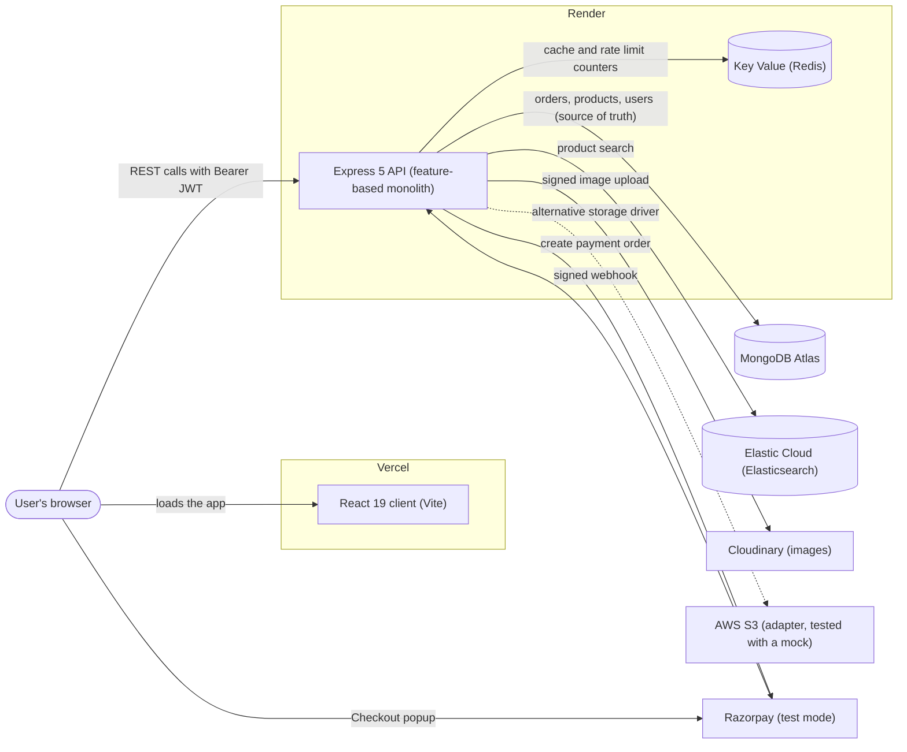
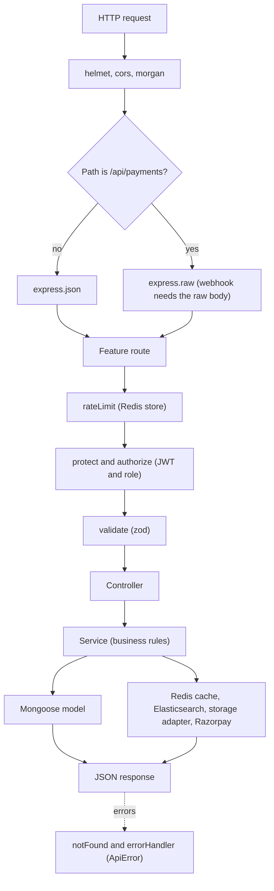
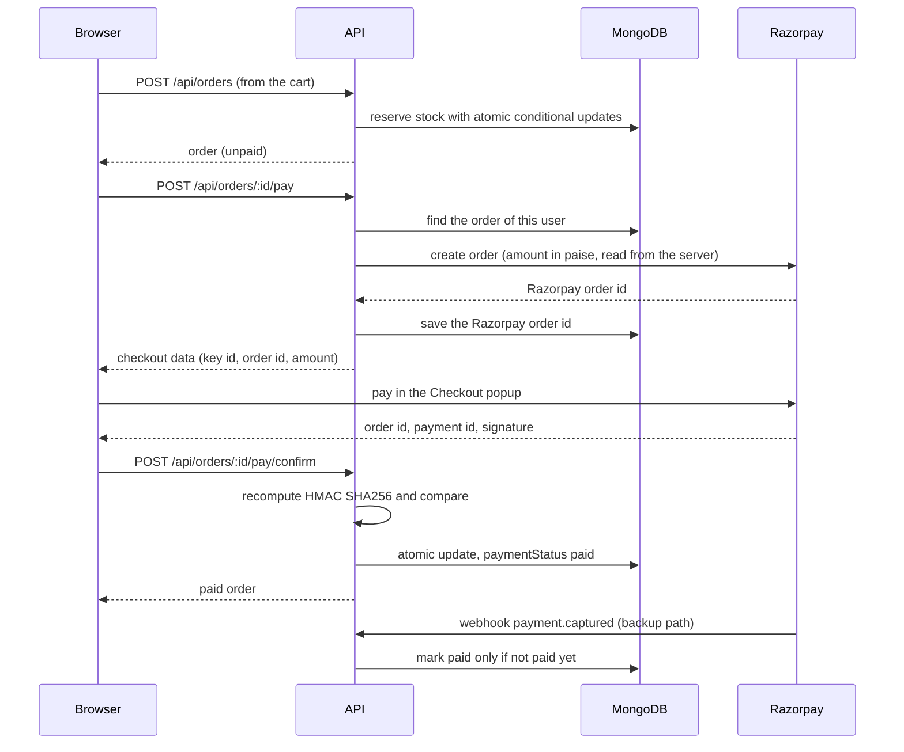
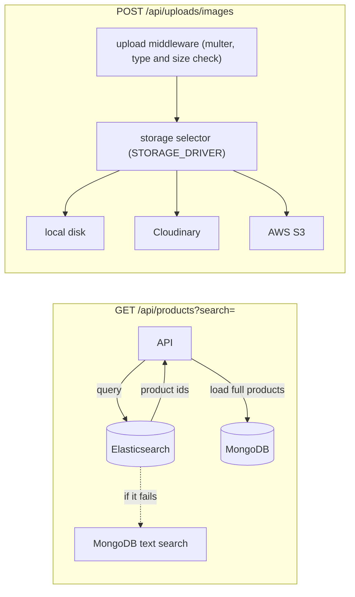

# ShopSphere Architecture

ShopSphere is a feature-based monolith: one Express API with one folder per feature, a React client, and managed services for data, cache, search, images and payments.

## 1. System overview

## 2. Inside the API

Every request passes through the same pipeline. A route adds only the steps it needs.

## 3. Placing and paying for an order

## 4. Search and image upload

## Design decisions

- **One deployable API, one folder per feature.** Features stay separated (routes, controller, service, model), so a feature can be moved out later, but there is no network hop between them.
- **MongoDB is the source of truth.** Elasticsearch holds a copy used only to find product ids. `npm run reindex` rebuilds the copy.
- **Services fail soft.** If Redis is down, requests go straight to MongoDB and rate limit counters are skipped. If Elasticsearch is down, search falls back to MongoDB text search.
- **The server decides money.** The client never sends an amount. The payment signature is verified on the server, and the webhook is a backup if the browser closes after paying.
- **Storage is pluggable.** The upload controller calls one `saveImage` function, and `STORAGE_DRIVER` picks local disk, Cloudinary or S3.
- **Stock safety without transactions.** Stock is reserved with atomic conditional updates and rolled back by hand if any item fails.
